# M5MorseMatrix-UserDemo README

## 产品主图

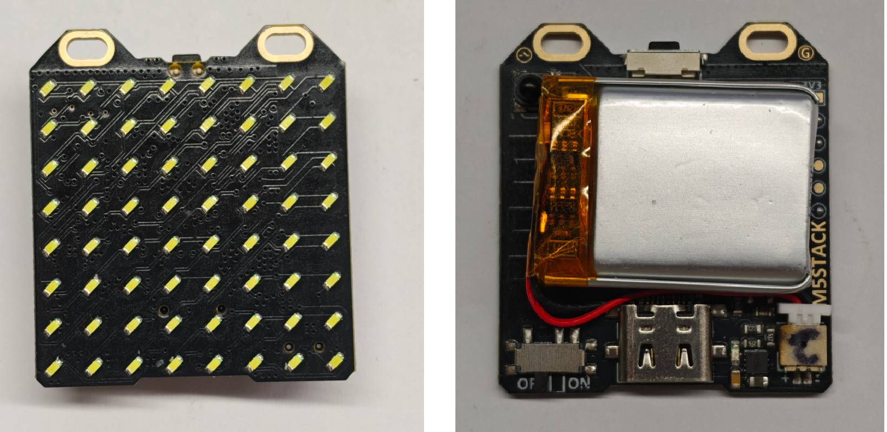

## 功能演示

### 1.打开背部开关到ON

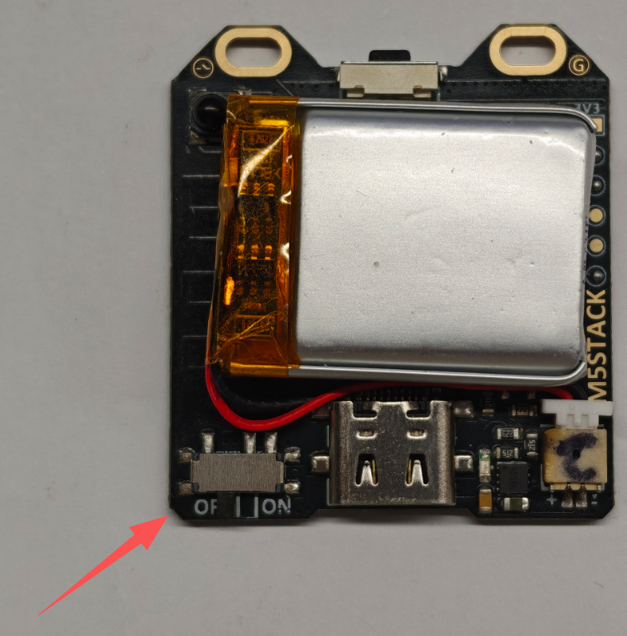

### 2.打开后会随机展示“斜向”和“回环”2种待机界面

### 3.此时单击，将进入2个LED呼吸效果的等待输入界面

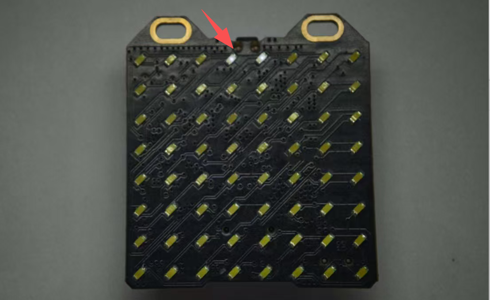

### 3.1. 输入方式1，直接敲击按键

单击松开，显示单个LED，长按则显示两个LED,如果长按操过8个则会返回到待机界面

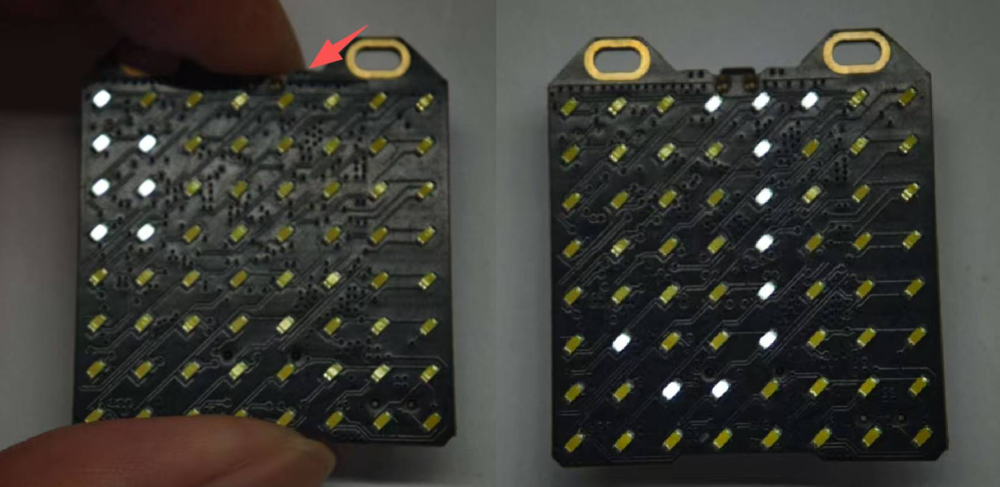

### 3.2. 输入方式2，通过Cardputer-Adv 的StringIR APP发送字符串

将Cardputer-Adv 烧录 FW目录下的MorseMatrix-工具箱 固件，或使用M5Burner 升级到 最新的Adv-0.3 及以上固件版本。更新固件启动后将看到，StringIR APP

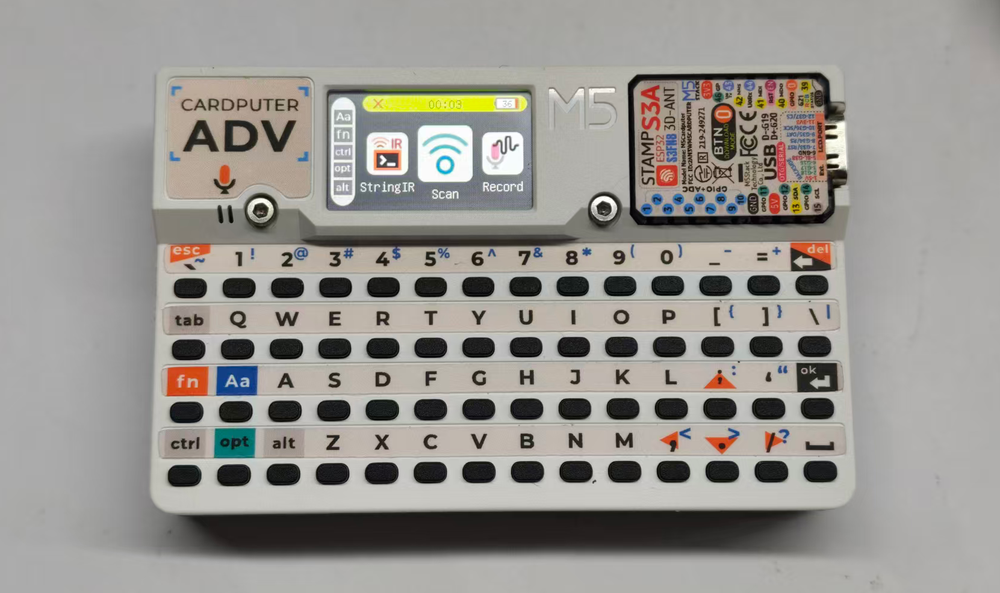

在文本框可以通过键盘键入任意ASCII可视字符

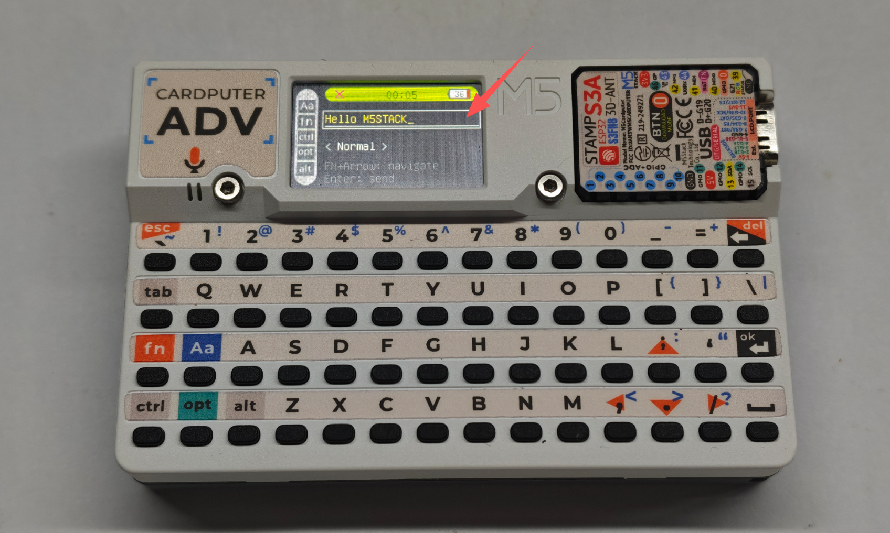

通过 FN+上下方向键 来使选择框上下移动，处于下方时，可通过 FN+左右方向键 使选项发生改变。

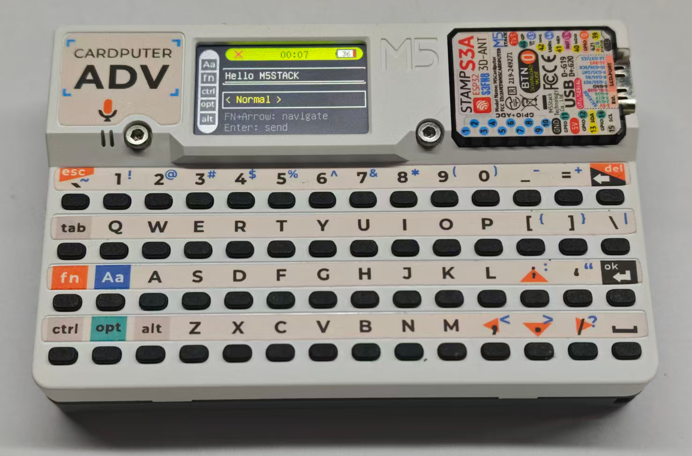

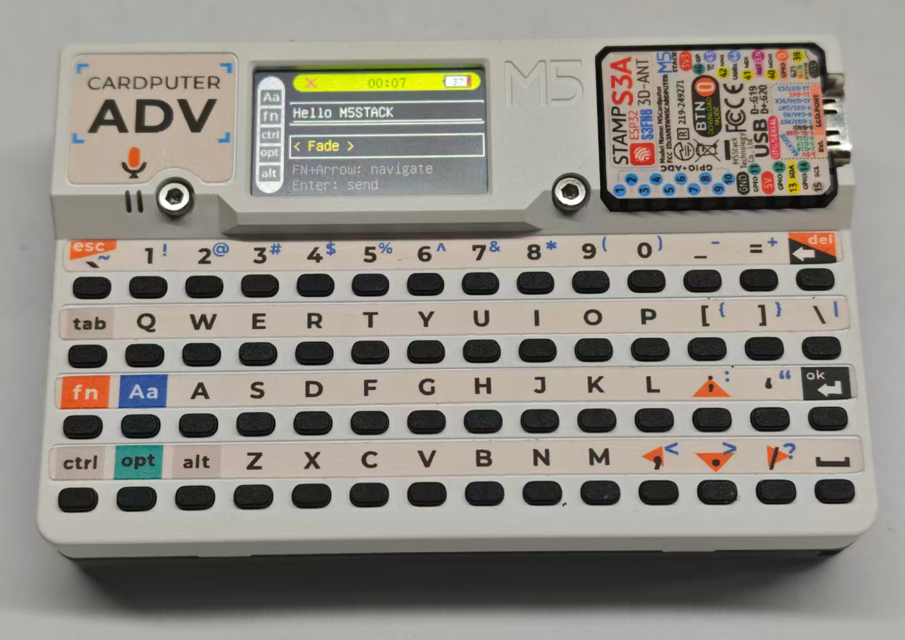

敲击回车则进行，进入IR发送进度界面

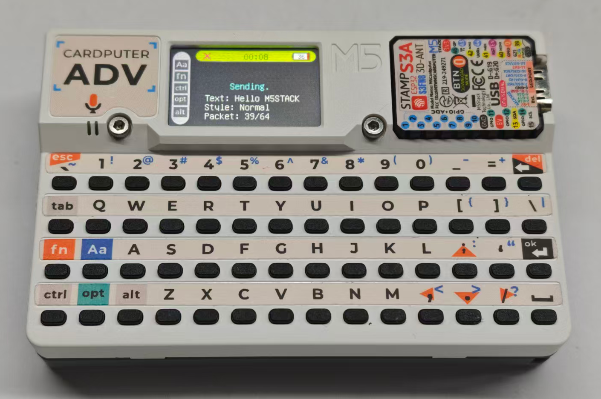

发送结束后，矩阵屏幕将根据选定的字体特效刷新字符串

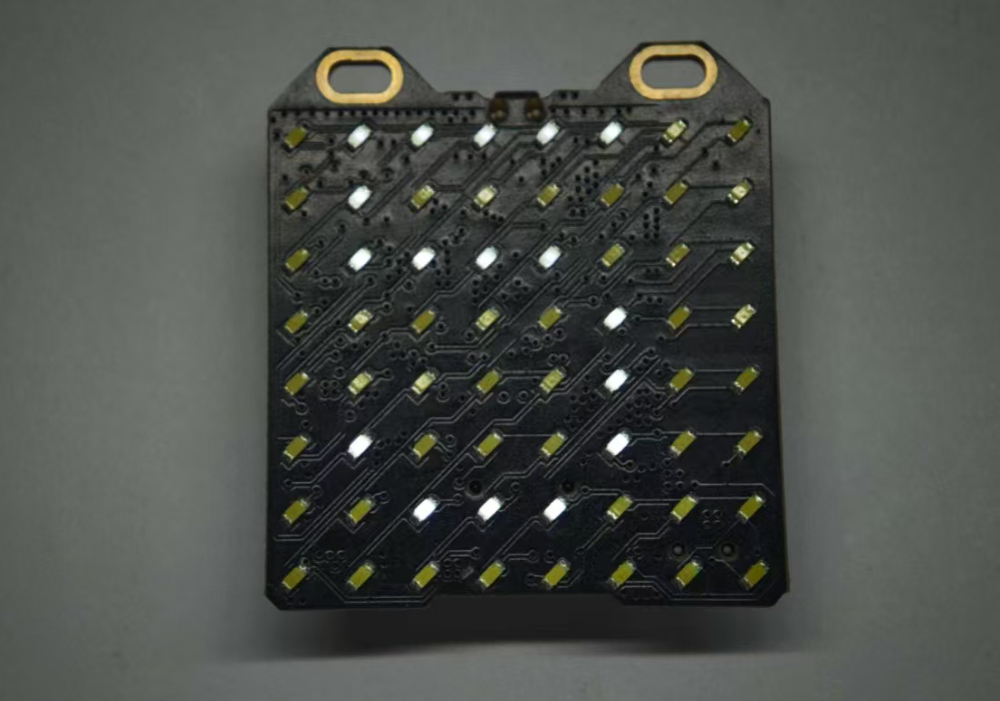

Normal：从右往左循环滚动显示字符串

Fade：渐明渐暗逐个循环显示字符

Stream：单双行穿插循环显示字符

### 3.3. 输入方式3，通过串口终端软件发送字符串

字符需要限制在ASCII可视字符范围内

插入USB线，且将界面切换到等待输入界面（注意该界面30秒后自动退出到待机界面）

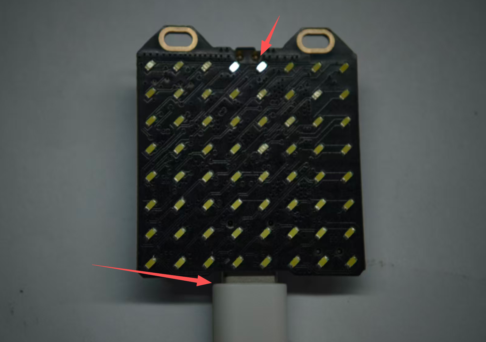

打开串口软件 (需要勾选/r/n发送) 或串口终端 (回车发送)

串口软件演示 (勾选发送新行，也就是/r/n) ：

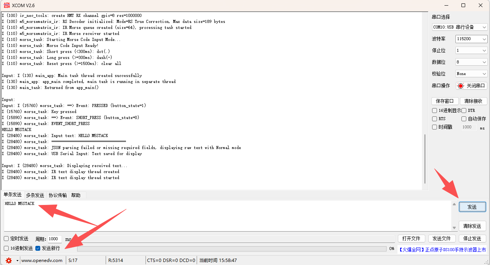

串口终端演示：

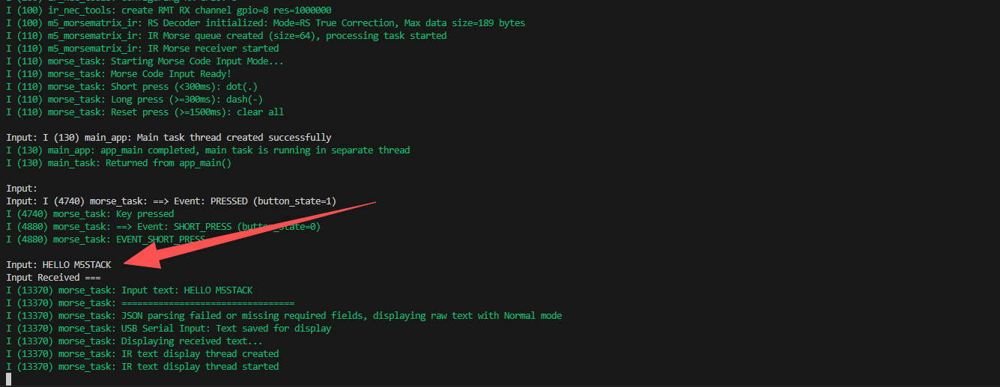

进阶演示，通过JSON格式数据，指定字符刷新的动画内容 (同样需要处在等待输入界面)：

示例：

{"text":"HELLO M5STCAK","style":"Normal"}

{"text":"HELLO M5STCAK","style":"Fade"}

{"text":"HELLO M5STCAK","style":"Stream"}

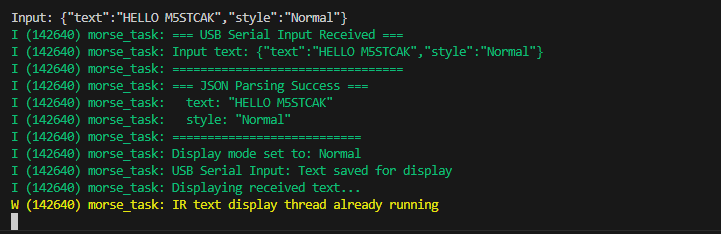

字符串显示界面点击可回到等待输入界面，再长按直到显示行呼吸效果返回待机界面
